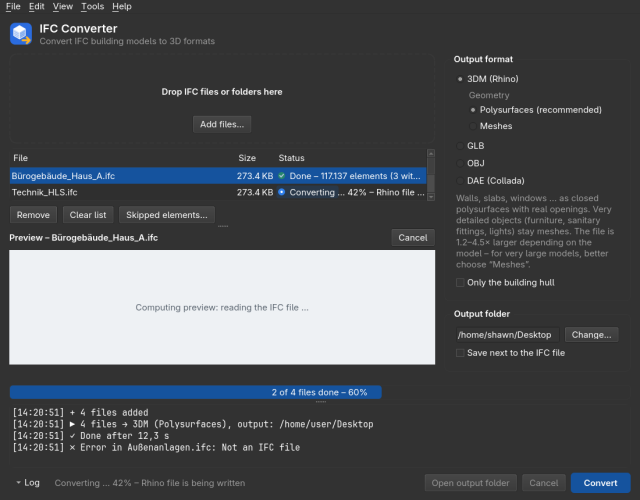

# IFC Converter

Convert IFC building models to **Rhino (3DM), GLB, OBJ and DAE** – with exact dimensions, without touching the IFC file, and without slowing down the other programs on your workstation. A desktop program for Windows and Linux, plus a command-line tool.

**[Download the latest release](https://github.com/Sh4wN98/IFC-Converter/releases/latest)** – Windows installer, portable ZIP, Linux tarball and this guide as a PDF (`IFC-Converter-<version>-Guide.pdf`). Die ausführliche deutsche Dokumentation steht in [docs/README-de.md](docs/README-de.md).

| Output | Extension | Good for |
|---|---|---|
| Rhino | `.3dm` | Rhino 7/8, Grasshopper – layers per storey and element class, IFC data as user text |
| glTF (binary) | `.glb` | web viewers, Three.js, Blender, game engines |
| Wavefront OBJ | `.obj` + `.mtl` | almost every 3D program |
| Collada | `.dae` | SketchUp, ArchiCAD, Blender |

Input: IFC2x3, IFC4 and IFC4.3 (also IFC2x2 and the IFC4x4 draft), as `.ifc` or packed `.ifczip`. ifcXML is not supported. Geometry is computed with [IfcOpenShell](https://ifcopenshell.org) and OpenCASCADE and written in metres.

## Contents

1. [Installation on Windows](#installation-on-windows)
2. [Installation on Linux](#installation-on-linux)
3. [Getting started](#getting-started)
4. [Output formats and options](#output-formats-and-options)
5. [3D preview](#3d-preview)
6. [Accuracy](#accuracy)
7. [Large models](#large-models)
8. [Language](#language)
9. [Log file, privacy and feedback](#log-file-privacy-and-feedback)
10. [Command line](#command-line)
11. [Development](#development)
12. [License](#license)

## Installation on Windows

The converter installs like any Windows program; Python is not needed.

- **Installer:** double-click `IFC-Converter-<version>-Setup.exe` from the [releases](https://github.com/Sh4wN98/IFC-Converter/releases). No administrator rights: it installs for the signed-in user only (`%LOCALAPPDATA%\Programs\IFC Converter`) with a Start menu entry. A desktop icon and an “Open with” entry for `.ifc` files are optional and off by default; the default program for IFC files is never changed. No services, no autostart, no background updates, no internet connection while running.
- **Portable:** unpack `IFC-Converter-<version>-portable.zip` (for example into Documents) and start `IFC Converter.exe`. Nothing is installed.
- **Windows SmartScreen:** the program is not code-signed, so the first start shows “Windows protected your PC”. Click **“More info” → “Run anyway”**. If the company virus scanner blocks the program, ask IT for an exception for the program folder.
- **Update:** run the installer of the new version. It replaces the old one; settings are kept. If the converter is still running (window or `ifc-convert`), the installer asks you to close it first and changes nothing – a running conversion is never interrupted.
- **Always the newest version:** these links never change: [IFC-Converter-Setup.exe](https://github.com/Sh4wN98/IFC-Converter/releases/latest/download/IFC-Converter-Setup.exe), [IFC-Converter-Guide.pdf](https://github.com/Sh4wN98/IFC-Converter/releases/latest/download/IFC-Converter-Guide.pdf), [IFC-Converter-portable.zip](https://github.com/Sh4wN98/IFC-Converter/releases/latest/download/IFC-Converter-portable.zip) (and `…/latest/download/SHA256SUMS.txt`). They point to the latest release, so a shared folder or an intranet page can link to them once.
- **Uninstall:** Windows Settings → Apps → “IFC Converter”. Settings and log files (`%APPDATA%\IFC Converter`, `%LOCALAPPDATA%\IFC Converter`) are left in place and can be deleted by hand.
- **Command line:** `ifc-convert.exe` sits next to `IFC Converter.exe` with the options described [below](#command-line).

## Installation on Linux

For Linux (x86_64, any current desktop distribution) there is `IFC-Converter-<version>-linux-x86_64.tar.gz` in the releases; Python is not needed.

```bash
tar xzf IFC-Converter-<version>-linux-x86_64.tar.gz
cd IFC-Converter-<version>-linux-x86_64
./install.sh
```

- **No root, current user only:** `install.sh` copies the program to `~/.local/opt/ifc-converter`, creates the commands `~/.local/bin/ifc-converter` (window) and `~/.local/bin/ifc-convert` (command line), an application menu entry with icon and an “Open with” entry for `.ifc` files. Another location: `IFC_CONVERTER_PREFIX=/path ./install.sh`.
- **Without installing:** run `ifc-converter/ifc-converter` (window) or `ifc-converter/ifc-convert house.ifc -f 3dm` straight from the unpacked folder.
- **Update:** run `install.sh` of the new version; the program folder is replaced in one go, settings are kept. `install.sh` refuses while the converter is running.
- **Uninstall:** `~/.local/opt/ifc-converter/uninstall.sh` (also in the unpacked folder) removes program, commands, menu entry, icon and MIME type. Settings and log files are left in place.
- **Wayland / X11:** Qt picks the display system itself; both plugins are included. If one of them makes trouble (no window, black preview), force the other: `QT_QPA_PLATFORM=xcb ifc-converter` or `QT_QPA_PLATFORM=wayland ifc-converter`. The 3D preview draws with OpenGL 3.3 (Mesa is enough, also in a VM); without it, it falls back to its own software renderer.
- **System libraries:** Qt, IfcOpenShell, rhino3dm, NumPy and their dependencies are included; from the system the program only needs OpenGL/EGL, xcb, the Wayland client libraries, fontconfig, D-Bus and GLib. `install.sh` reports what is missing (Ubuntu/Debian: `sudo apt install libxcb-cursor0 libxcb-icccm4 libxcb-image0 libxcb-keysyms1 libxcb-render-util0 libxcb-shape0 libxcb-xinerama0 libxcb-randr0 libxcb-xfixes0 libxcb-sync1 libxcb-xkb1 libxcb-shm0 libxcb-glx0 libgl1 libegl1`).
- **Where things are:** settings `~/.config/ifc-converter/settings.ini`; log file `~/.local/state/ifc-converter/logs/ifc-converter.log` (Help → Save log file…); remembered problem elements `~/.local/state/ifc-converter/quarantine.json` (right-click a file → “Try the skipped elements again” forgets them); preview cache `~/.local/state/ifc-converter/previews`; output that could not be copied `~/.local/state/ifc-converter/rescued`. `XDG_CONFIG_HOME` / `XDG_STATE_HOME` are respected; temporary files go to `/tmp`.
- **Checksums:** `SHA256SUMS.txt` in the release covers all files: `sha256sum -c SHA256SUMS.txt` in the download folder.
- Not available on Linux: the memory limit (job object) and the standby lock exist on Windows only; low priority, the separate conversion process and the restart after a crash work on both.

## Getting started



1. **Add files:** drag IFC files or whole folders into the window, or click “Add files…”. The 3D preview of the selected file builds up while it is computed.
2. **Pick the output format** on the right. For Rhino choose **Polysurfaces** (real openings, editable, 1.2–4.5× larger file) or **Meshes** (smallest file, fastest conversion – the better choice for very large models).
3. **Check the output folder** (default: Desktop) or tick “Save next to the IFC file”. If a file name exists already, “(2)”, “(3)” … is appended – nothing is overwritten.
4. **Click Convert.** Progress is shown per file; “Open output folder” takes you to the result. Files added during a conversion are queued and converted right after it with the same settings.

If a file fails, the log says where the details are (Help → Save log file…). “Internal error (…)” means an error in the program itself – please send the log file (see [feedback](#log-file-privacy-and-feedback)).

## Output formats and options

### Rhino (.3dm)

- **Polysurfaces** (default): walls, slabs, windows, doors, beams etc. become closed, planar polysurfaces in metres; coplanar faces are merged, window and door openings are real holes. Faceted round things (pipes, ducts, round columns, reinforcement, sanitary objects), very detailed objects (over 1000 triangles) and Revit placeholders (RPC trees/people) stay meshes, as does anything that does not give a valid polysurface.
- **Meshes:** every element becomes one mesh object – the smallest file and the fastest conversion. Round surfaces are shaded smooth, edges stay sharp.
- **Curved surfaces** stay faceted, because Revit & Co. store them as triangles in the IFC already. The converter does not create NURBS surfaces.
- **Layers** follow the spatial structure: `Storey::IfcClass` (e.g. `Ground floor::IfcWall`), with the building in front when a file holds several; bridges, roads and rail (IFC4.3): `Facility::Part::IfcClass`. Elements outside the structure go to `Ohne Geschoss` (the layer names are German and not translated, like `Achsen` for the axes and `Blockdefinitionen` for the blocks). Alignments (`IfcAlignment`) and grids (`IfcGrid`) become polylines.
- **Object name** = IFC name, colour from the IFC material or style. An element with several materials (window: frame and glass) becomes one object per material, grouped under the element's name, so glass stays transparent. Assemblies (`IfcElementAssembly`, curtain walls, stairs, roofs made of parts) form a group named after the assembly.
- **User text** on every object: GlobalId, IFC class, name, type name, `IfcPredefinedType`, `IfcObjectType`, `IfcTag` (e.g. the Revit element ID), storey, the property sets and the standard quantities (`BaseQuantities` / `Qto_…`: areas, volumes, lengths in m, m², m³). Placeholder values (“N/A”, “-”, “UNSET” …) and vendor quantity dumps (`ArchiCADQuantities`) are left out. Document user text holds the IFC file name, schema, project name and the georeferencing from `IfcMapConversion` if present (eastings, northings, height and scale as they apply to the metre geometry, rotation in degrees).
- **Blocks** (option, off by default; `--blocks`): type geometry shared by several elements (windows, doors, furniture) is stored once as a block definition and each element as a block instance with its own user text, layer and colour. Files get 20–45 % smaller, conversions with polysurfaces faster. Block instances must be exploded in Rhino before editing (`_Explode`); the block definitions sit on the layer `Blockdefinitionen`, which must stay visible.
- Written in the Rhino 7 format, opens in Rhino 7 and 8.

### GLB, OBJ, DAE

Meshes with colours, Z up, metres. GLB nodes and OBJ groups are named after the element's GlobalId (DAE: `product-<GlobalId as UUID>-body`, since XML ids cannot hold a `$`). GLB stores every element around its insertion point, so georeferenced models keep full precision; OBJ writes coordinates with 15 digits, with unwelded vertices so edges stay sharp in Blender & Co. GLB is limited to 4 GB of output – use 3DM or OBJ for huge models.

### Only the building hull

The checkbox **“Only the building hull”** under the output format (command line: `--envelope`, short `--hull`; any output format) converts only what is seen from outside: exterior walls, roofs, windows, doors, balconies, canopies, terrain. Interior walls, floors, furniture, sanitary fittings, pipes and ducts – most of the geometry of a building model – are left out.

- **For:** context models (the neighbouring building in an urban model), weaker workstations and models whose full output would be several GB. Elements are only left out, never changed: what arrives is as accurate as always.
- **How it decides:** a coarse pass computes all geometry roughly first (the first 25 % of the progress, “Determining the building hull …”). Surfaces are entered into a 5 cm grid (coarser for very large models or little RAM; the log names the cell size), outside air is flooded in from the edge of the grid, and an element belongs to the hull as soon as any of its cells touches outside air. Glass counts as opaque. Elements marked external in the IFC (`IsExternal`) are kept, as are elements the coarse pass could not compute – unless nearly every element the outside air does not reach carries the mark (some exports mark everything external): then the marks tell nothing, the fill alone decides, and the log says so. When the fast kernel hangs in the coarse pass, the converter remembers the file and starts the coarse pass with OpenCASCADE the next time. If the model has no closed hull (no roof or slabs), the properties and element classes decide instead, and the log says so.
- **Cost:** small models take somewhat longer than without the option, large ones get faster, because only the hull is computed precisely and written. The log reports how many elements were inside and left out.

### Settings (Tools → Settings)

- **Performance:** threads and priority. The default keeps about half the logical cores busy at low priority, so Rhino, Revit and other programs stay responsive; “Automatic” uses fewer when little RAM is free.
- **Geometry kernel:** **Accurate** (default) computes every element with OpenCASCADE and is complete and identical on every run; only pure triangle meshes (terrain) take the fast path. **Fast** (hybrid) is 3–13× faster but may drop or duplicate faces of single elements. **OpenCASCADE only** computes terrain with OpenCASCADE as well.
- **Output:** identical elements as blocks (see above).
- **Log file:** where the log and the settings are, and “Save log…”.

## 3D preview

Below the file list a preview shows the selected file (View → Preview, F3). It is computed in a child process at low priority and cached, so a file shows at once the next time.

- The preview starts on its own when the free memory has room for the file – also beside a running conversion (then with 4 instead of 8 threads); otherwise after a click on “Compute preview”. It builds up while it is computed: every few seconds a new batch arrives, structure first (terrain, slabs, roofs, walls, columns, beams, stairs, façades, windows, doors). Reading the IFC alone takes about 35 s per 600 MB; after that the first picture appears within seconds.
- Furniture, building services (pipes, ducts, cables, fittings), fasteners, reinforcement and very deeply nested elements are left out; the line under the view says how many (“3,210 details left out (furniture, MEP)”). At most 3 million triangles: beyond that the smallest elements go first. After a cancel, crash or error what is shown stays; after the second crash of the geometry kernel the preview stops trying, “Try again” starts over.
- Drawn with the graphics card (OpenGL 3.3); models with millions of triangles stay fluid. Without a usable graphics driver (remote desktop, virtual machine) Qt falls back to the bundled software OpenGL; if that fails too, the preview draws itself (largest elements only). `IFC_CONVERTER_PREVIEW_RENDERER=software` forces the built-in renderer.
- Cache: `%LOCALAPPDATA%\IFC Converter\previews` (Linux: `~/.local/state/ifc-converter/previews`), at most about 2 GB, never next to the IFC file.

| Action | Mouse / key |
|---|---|
| Orbit | drag with the left mouse button (around the clicked point) |
| Pan | drag with the middle or right button, or Shift + left button |
| Zoom | mouse wheel, towards the cursor |
| Whole model | double-click, `F` or the “Fit” button |
| Views | view bar buttons or keys `1` Iso, `2` Top (north up), `3` Front (from south), `4` Side (from east); `Home` = start view |
| Element info | click an element (without dragging) to see class, GlobalId and name; `Esc` clears |
| Display | view bar buttons for edge lines (`E`) and perspective/parallel projection (`P`) |

## Accuracy

- **Units:** output is always in metres, whether the IFC is in mm, m, feet or inches. The Rhino file has unit metres, absolute tolerance 0.001 m and angle tolerance 1°.
- **Coordinates:** elements lie in the project coordinates of the IFC, as in the authoring program. A georeference (`IfcMapConversion`) is not applied; in `.3dm` its values are in the document user text. Hundreds of kilometres from the origin the coordinates stay exact: `.3dm` stores them in double precision, `.obj` with 15 digits, `.glb` per element around its insertion point.
- **Flat geometry** (walls, slabs, openings, profiles) comes out exact to the vertex. Measured on 11 real models (mm, m, feet; IFC2X3, IFC4, IFC4X3) against IfcOpenShell's own geometry and the dimensions in the IFC: deviation below 0.001 mm in `.3dm` and `.obj`, below 0.02 mm in `.glb`.
- **Round geometry** (columns, pipes, arcs) is faceted: the vertices lie exactly on the curve, the chords at most 0.25 mm inside with the default kernel. A thin pipe (Ø 10 cm) has about 0.6 % less volume.
- **Check it yourself:** `tools/accuracy.py` converts an IFC in all formats and compares every element with IfcOpenShell's geometry and the dimensions in the IFC:

```bash
python tools/accuracy.py model.ifc --out-dir out --report accuracy.md
```

## Large models

- **Memory:** the IFC file is read completely; that alone takes about 6× its size, the conversion 1–2 GB more, and with `.3dm` the output stays in memory until it is saved. **Rule of thumb: a 2 GB IFC needs about 14–16 GB of RAM.** The converter warns before starting if too little is free, but converts anyway.
- **Geometry in batches** of 200 elements; memory is released after every batch and the number of threads adapts to the free RAM. Deeply nested geometry (over 100 levels of `IfcBooleanResult` or `IfcMappedItem`) is computed first, one element at a time in a thread with a big stack – with Windows' default 1 MB stack such models overflowed or hung.
- **Crash or hang of single elements:** if the conversion crashes or stops computing, it is ended and restarted automatically; only the elements that were not finished are suspect and are computed first and one by one in the new attempt, and an element that hangs or crashes again is skipped. A geometry kernel that keeps a thread busy without delivering anything (20 min in the fine pass, 5 min in the hull pass, 3 min in the preview) is abandoned the same way, inside the conversion process. If the process keeps computing in a kernel phase without reporting any progress, phase or position for that limit plus 5 minutes (25, 10 and 8 min), it is ended and restarted like after a crash, since IfcOpenShell holds the interpreter lock while it computes and the process's own limits cannot act then; a minute before that, faulthandler writes the stacks of its threads into the log. A hang or crash in the hull's rough pre-computation (hybrid kernel) repeats the pre-computation with OpenCASCADE. Skipped elements are named in the window with class, GlobalId and name and listed under right-click → “Skipped elements…” (copy as a table for Excel); they are remembered per file, so the next conversion of the same unchanged file skips them at once. For Rhino output the finished batches are checkpointed in the temp folder, so a restart computes only the rest.
- **Own process:** every conversion runs in its own process. If the system kills it for lack of memory, only that file is marked as failed and the next one is converted. “Cancel” acts immediately, even while the IFC is still being read.
- **Network drives:** output to a network folder is written locally first and then copied in one go (up to four retries over a `.part` file); if the copy fails, the finished file stays in `%LOCALAPPDATA%\IFC Converter\Ausgabe` and the message says so.
- **Consideration for other programs:** a conversion keeps about half the logical cores busy (two thirds as geometry threads, the rest for the helper processes that build polysurfaces), at “below normal” priority and, on Windows, lower memory priority; conversion and helpers run in a Windows job object limited to 85 % of the RAM, so a runaway conversion never pushes other programs into the page file. Windows does not go to standby during a conversion.
- **GLB** is limited to 4 GB of output; take `.3dm` or `.obj` for huge models.

Reference values from the stress test with 64 freely available models (laptop, 8 cores / 8 GB RAM, fast kernel):

| Model | IFC | Elements | `.3dm` meshes | `.3dm` polysurfaces | `.glb` | Peak RAM (meshes) |
|---|---|---|---|---|---|---|
| UpTown (35 storeys, FZKViewer) | 1.3 GB | 33,132 | 7.5 min | – | 5.5 min | 5.8 GB |
| UpTown (ARCHICAD) | 445 MB | 50,557 | 9.5 min | – | 5.5 min | 3.5 GB |
| Holter Tower (50 storeys, ArchiCAD) | 177 MB | 60,541 | 4 min | 7 min (818 MB) | 2.5 min | 1.7 GB |
| Landsarkivet (Revit, georeferenced) | 178 MB | 10,056 | 5.5 min | 15.5 min (691 MB) | 4.5 min | 3.7 GB |
| 210 King Street (39 storeys, 3 models) | 155 MB | 12,934 | 2 min | 3 min | 1.5 min | 1.3 GB |
| ACCA Viadotto Acerno (bridge, IFC4.3) | 33 MB | 6,546 | 1.5 min | 2.5 min | 1.5 min | 1.5 GB |

With the default kernel “Accurate” conversions take 1.2–2× as long on the laptop, up to 8× for small models with many detailed Revit families; on machines with many cores the difference shrinks. Polysurfaces make the output 1.2–4.5× larger than meshes and keep it in memory until it is saved – for models above a few hundred MB, meshes are usually the better choice.

**What the converter repairs itself:** merged discipline models with several `IfcProject` (units would otherwise be ignored), wrongly declared units (feet without type, area as length), empty representations of single elements, structural analysis models (nodes and member axes are skipped, surface members converted), IFC2X2 read as IFC2X3 and the IFC4X4 draft as IFC4X3 with substitute classes. Elements without computable geometry are counted and reported.

## Language

The window, dialogs, status lines, tooltips and log messages are available in English (default), German, French, Spanish, Italian, Portuguese, Dutch, Polish and Turkish: Tools → Language, then restart. Without a saved setting – and for the command line – the environment variable `IFC_CONVERTER_LANG` (`de`, `fr`, …) counts; `ifc-convert` also takes `--lang`. Layer names, user text and the output files themselves are not translated; the German texts are the originals.

## Log file, privacy and feedback

- The converter writes a log to `%LOCALAPPDATA%\IFC Converter\logs\ifc-converter.log` (Linux: `~/.local/state/ifc-converter/logs/ifc-converter.log`; about 4 MB, older parts are overwritten). It stays on this PC: the converter sends nothing and needs no internet connection.
- **The log is always anonymised.** It never contains user or computer names (`<user>` / `<computer>`), servers and shares of network drives (`<server>` / `<share>`), folder names (`<folder>`), file names (`File-1.ifc`, `File-1.3dm` … – the same file keeps the same number) or element names. IFC class and GlobalId, times, sizes, versions and error messages stay, so problems can be traced without personal data. There is no switch for this.
- **To send it,** choose Help → “Save log file…” (also in the error dialog and under Settings → Log file): a copy of the whole log, by default `ifc-converter-log.txt` on the Desktop. Have a look before sending.

**How to report a problem:** save the log file, take a screenshot in Rhino or the target program if something is visibly wrong (missing parts, wrong position), and send both with one sentence (“file X, meshes, hull only – windows missing on the ground floor”).

## Command line

`ifc-convert` (Windows: `ifc-convert.exe` next to `IFC Converter.exe`) has the same options as the window:

```bash
ifc-convert house.ifc                      # → house.glb
ifc-convert house.ifc -f obj               # → house.obj + house.mtl
ifc-convert house.ifc -f dae               # → house.dae (Collada, meshes with colours, Z up, metres)
ifc-convert house.ifczip                   # packed IFC is read directly
ifc-convert house.ifc -f 3dm               # → house.3dm (Rhino, polysurfaces)
ifc-convert house.ifc -f 3dm -g mesh       # → house.3dm with meshes only
ifc-convert house.ifc --envelope           # only the building hull
ifc-convert house.ifc -o export/model.glb  # own output path
ifc-convert *.ifc -d output/               # several files into one folder
```

| Option | Meaning |
|---|---|
| `-f, --format {glb,obj,3dm,dae}` | output format (default `glb`) |
| `-g, --geometry {brep,mesh}` | 3dm only: polysurfaces or meshes (default `brep`) |
| `--blocks` | 3dm only: identical elements as blocks |
| `--envelope`, `--hull` | only the building hull; the result line names the elements left out (“… inside left out”) |
| `-o, --output PATH` | output file (one input file only) |
| `-d, --out-dir FOLDER` | output folder for several files |
| `--overwrite` | replace an existing output file (default: a free name such as `name (2).3dm`, like the window) |
| `-j, --threads N` | geometry threads (default: automatic, about half the cores together with the helper processes; `ifc-convert --help` shows the number for this PC) |
| `--normal-priority` | convert at normal instead of low priority |
| `--kernel {accurate,hybrid,opencascade}` | geometry kernel (default `accurate`) |
| `--lang {en,de,fr,es,it,pt,nl,pl,tr}` | language of the conversion messages (default `IFC_CONVERTER_LANG`, else English) |

With the environment variable `IFC_CONVERTER_PROGRESS=lines` the progress also reaches programs that run `ifc-convert` with redirected output (the [Rhino plugin](https://github.com/Sh4wN98/Rhino-IFC-Plugin)): one line per change on stdout, `@status <text>`, `@percent <n>` and `@phase <phase> <text>`.

Ctrl+C cancels: exit code 130, half-written output and temporary files are removed. Without arguments (double-click) `ifc-convert` starts a terminal mode: drop files into the console window, press Enter, type `3dm`, `glb` or `obj` to switch the format, `q` to quit.

From Python:

```python
from ifc_converter import convert

result = convert("house.ifc", fmt="3dm", progress=lambda pct: print(f"{pct} %"))
print(result.output, result.elements)
```

## Development

### Setup and tests

Python 3.10 or newer. From the source, `start.bat` (Windows) or `./start.sh` (Linux/macOS) sets up a virtual environment on first start (internet needed for IfcOpenShell, rhino3dm and Qt) and opens the window. By hand:

```bash
python3 -m venv ~/.local/share/venvs/ifc-file-converter   # on a drive with symlinks (not exFAT)
source ~/.local/share/venvs/ifc-file-converter/bin/activate
pip install -e ".[dev]"
pytest
```

The tests run with `QT_QPA_PLATFORM=offscreen` and need no display.

### Building the Windows and Linux apps

The apps are [PyInstaller](https://pyinstaller.org) program folders from one spec (`packaging/ifc_converter.spec`): on Windows `IFC Converter.exe` without console and `ifc-convert.exe`, on Linux `ifc-converter` and `ifc-convert`. From them come the portable ZIP and, with [Inno Setup](https://jrsoftware.org/isinfo.php), the installer on Windows, and the tarball with `.desktop` file, icon, MIME type, `install.sh` and `uninstall.sh` on Linux (`packaging/linux/`).

**GitHub Actions** (`.github/workflows/build.yml`) on every push: tests on Linux and Windows; build of the Windows app, portable ZIP and installer; build of the Linux app and tarball; smoke test of the built exe (`packaging/smoke_test.py`: a 5 × 0.2 × 3 m wall in all formats with dimension checks, UNC output, deeply nested geometry, cancelled and killed conversions without leftovers in the temp folder, window start); installer test (`packaging/installer_test.py`: update from the last release, silent install, refusal while running, uninstall); Linux smoke test (`packaging/smoke_test_linux.py`: the same conversions, `ldd` over all libraries, the Qt platform plugins xcb, Wayland and offscreen; the tarball installed, updated and uninstalled in a test HOME); the user guide PDF (`packaging/guide.py`). Installer and ZIP are kept 7 days as the artifact `IFC-Converter-windows`, the tarball as `IFC-Converter-linux`.

**Releasing a version:** raise `version` in `pyproject.toml`, add the section to `CHANGELOG.md` (its top section becomes the release text, `packaging/release_notes.py`), commit, push, then tag:

```bash
git tag v0.9.0
git push origin v0.9.0
```

The workflow builds and tests as above and creates a GitHub release with installer, portable ZIP, Linux tarball, guide PDF and `SHA256SUMS.txt`. A tag that does not match the version in `pyproject.toml` or the changelog stops the build. Tags are never moved: a failed release gets a new patch version.

**Building locally** – Windows (Python 3.13 and [Inno Setup 6](https://jrsoftware.org/isdl.php)):

```bat
py -3.13 -m venv .venv-build
.venv-build\Scripts\python -m pip install -c packaging\constraints.txt ".[build]"
.venv-build\Scripts\python packaging\build.py
.venv-build\Scripts\python packaging\smoke_test.py "dist\IFC Converter" --gui
```

Linux (Python 3.13 or newer):

```bash
python3 -m venv ~/.local/share/venvs/ifc-build
~/.local/share/venvs/ifc-build/bin/python -m pip install -c packaging/constraints.txt ".[build]"
~/.local/share/venvs/ifc-build/bin/python packaging/build.py
python packaging/smoke_test_linux.py dist/ifc-converter --gui --tarball dist/IFC-Converter-*-linux-x86_64.tar.gz
```

The program folder contains symbolic links; on a drive without them (exFAT) use `build.py --build-root ~/path`, and give `smoke_test_linux.py --work` a folder on a drive with links. `packaging/constraints.txt` pins the exact versions of IfcOpenShell, rhino3dm, Qt, NumPy and PyInstaller for tests and builds; after updating them, check the accuracy on real models again.

### Tools

- `tools/accuracy.py` – compares every element of the output with IfcOpenShell's geometry and the dimensions in the IFC.
- `tools/benchmark.py` – converts IFC files in all formats, each in its own process, and reports time, peak RAM, output size and output checks: `python tools/benchmark.py models/*.ifc --modes 3dm-brep,3dm-mesh,glb --out-dir out --report report.md`.
- `tools/hull_check.py` – checks the building hull option against `IsExternal` and renders the kept and left-out elements.
- `tools/guide_screens.py` – renders the preview figure of the user guide offscreen.

## License

IFC Converter is free software under the [GNU General Public License, version 3 or later](LICENSE). The released programs bundle IfcOpenShell (LGPL-3.0, with OpenCASCADE, CGAL and others), Qt / PySide6 (LGPL-3.0), rhino3dm (MIT), NumPy (BSD) and Python (PSF); see `packaging/THIRD-PARTY-NOTICES.txt` and the `licenses` folder next to the program.
